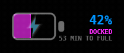

<div align="center">

# Basilisk Power

**Battery, charging and LED control for the Razer Basilisk V3 Pro — wired, wireless, or on the Mouse Dock Pro.**
**No Synapse required.**


[](https://github.com/Anu-bhav/razer-basilisk-power/releases/latest)


<p align="center">
  
  &nbsp;&nbsp;
  
  &nbsp;&nbsp;
  
  <br>
  <sub>Idle — wireless &nbsp;·&nbsp; Charging — docked with ETA &nbsp;·&nbsp; Charging pulse (8 s loop)</sub>
</p>

</div>

Basilisk Power is a small native Windows suite for one mouse: it reads the
battery through Razer's HID protocol, keeps a tray icon and a Rainmeter widget
in sync, estimates charging and discharge time, and controls the mouse and dock
LEDs independently. It talks to the hardware directly — no Synapse, no
OpenRazer kernel driver, no background service.

It began as a fork of
[razer-battery-tray-indicator](https://github.com/va0z-code/razer-battery-tray-indicator)
(Snake Charger, by va0z-code, based on xzeldon's snake-charger) and has since
grown a dock-relay implementation, a CLI, a colour picker, and a Rainmeter
skin. MIT licensed.

## What you get

| Piece | What it does |
| --- | --- |
| **Tray app** | Live percentage, charging state, toasts, ETA, autostart, diagnostics |
| **`basilisk-power-cli`** | Scriptable battery/LED reads and writes, history reports, hardware probing |
| **`led-picker`** | OpenRGB-style colour wheel with a separate colour for the mouse and the dock |
| **Rainmeter skin** | A compact matching widget fed by `status.json` |

The tray, CLI and picker share one HID library; the skin consumes the feed they
write. The tray is the long-running process; the CLI and picker open the
hardware only when needed.

## Download

Prebuilt Windows x86_64 binaries are attached to every
[release](https://github.com/Anu-bhav/razer-basilisk-power/releases/latest).
They are standalone executables — no Rust toolchain, no installer, no extra
DLLs.

| Binary | Purpose | Direct download |
| --- | --- | --- |
| `basilisk-power.exe` | Tray app (the main program) | [Download](https://github.com/Anu-bhav/razer-basilisk-power/releases/latest/download/basilisk-power.exe) |
| `basilisk-power-cli.exe` | Battery + LED command line tool | [Download](https://github.com/Anu-bhav/razer-basilisk-power/releases/latest/download/basilisk-power-cli.exe) |
| `led-picker.exe` | Mouse + dock colour picker | [Download](https://github.com/Anu-bhav/razer-basilisk-power/releases/latest/download/led-picker.exe) |

Also attached: `BasiliskPower-1.0.4-win64.zip` with all three executables and the
Rainmeter skin, plus `SHA256SUMS.txt` for verification:

```powershell
Get-FileHash .\basilisk-power.exe, .\basilisk-power-cli.exe, .\led-picker.exe -Algorithm SHA256
```

Each executable is built from the tagged commit, so `--version` and the tray
menu report the same build hash. To install manually, put the three `.exe` files
in `%LOCALAPPDATA%\BasiliskPower` and start `basilisk-power.exe`; the skin can be
copied from the zip or installed with `deploy.ps1`.

## Contents

- [Download](#download)
- [Quick start](#quick-start)
- [Components](#components)
- [Battery features](#battery-features)
- [LED colour](#led-colour)
- [Rainmeter widget](#rainmeter-widget)
- [Tray flags](#tray-flags)
- [`basilisk-power-cli`](#basilisk-power-cli)
- [Data files](#data-files)
- [Building](#building)
- [Deploying](#deploying)
- [Verifying a change](#verifying-a-change)
- [2026-11 hardening pass](#2026-11-hardening-pass)
- [Dock quirks](#dock-quirks-learned-the-hard-way)
- [Rainmeter gotchas](#rainmeter-gotchas-baked-into-the-skin)
- [Disk hygiene](#disk-hygiene)
- [Troubleshooting](#troubleshooting)
- [Credits](#credits)

## Quick start

If you just want to run it, grab a binary from [Download](#download). The steps
below build from source.

Requirements: Windows 10/11, and — for building — WSL (or Linux) with a Rust
toolchain and the `x86_64-pc-windows-gnu` target. Rainmeter is optional.

```powershell
git clone git@github.com:Anu-bhav/razer-basilisk-power.git
cd razer-basilisk-power
$stage = Join-Path $env:TEMP "basilisk-power"
New-Item -ItemType Directory -Force $stage | Out-Null
Copy-Item .\deploy.ps1,.\verify.ps1 $stage -Force
pwsh -NoProfile -ExecutionPolicy Bypass -File "$stage\deploy.ps1" -Start
```

The deploy script builds all three executables, installs them under
`%LOCALAPPDATA%\BasiliskPower`, mirrors the skin into Rainmeter, starts the
tray, and waits for a healthy `status.json`. To start it with Windows, use the
tray menu or run `basilisk-power.exe --install-autostart` once.

## Components

| Path | Deliverable |
| --- | --- |
| [`app/`](app/) | **`basilisk-power.exe`** — the tray application. Its own crate; not a workspace member, because it needs GTK to build on Linux and is cross-compiled for Windows. |
| [`basilisk-power/`](basilisk-power/) | **`basilisk-power-cli.exe`** — battery and LED command line tool. |
| [`led-picker/`](led-picker/) | **`led-picker.exe`** — colour-wheel GUI for the mouse and dock LEDs. |
| [`skin/`](skin/) | **Rainmeter skin** — `basilisk.ini`, resources, and the frozen [`LAYOUT.md`](skin/LAYOUT.md). |
| [`razer-battery/`](razer-battery/) | Shared HID library: device discovery, battery protocol, dock relay, lighting. |
| [`research/`](research/) | Driver sources and notes used to reverse-engineer the dock protocol. |
| [`deploy.ps1`](deploy.ps1) | Build, install, health-check and roll back. |
| [`verify.ps1`](verify.ps1) | The regression gate. |
| [`REGRESSIONS.md`](REGRESSIONS.md) | The binding contract: behaviour that must not regress. |
| [`TROUBLESHOOTING.md`](TROUBLESHOOTING.md) | Symptom-first recovery guide. |

## Battery features

- **Three sources, one mouse.** Exactly three device IDs are probed:
  - `0x00AA` — Basilisk V3 Pro wired (USB cable)
  - `0x00AB` — Basilisk V3 Pro wireless (HyperSpeed dongle)
  - `0x00A4` — Mouse Dock Pro, relaying the paired mouse's battery

  When dock-paired the mouse presents *only* under the dock's PID, so it is
  shown as “Basilisk V3 Pro (Mouse Dock Pro)”. Wired mode still reports the
  cable charging percentage; docked charging runs through the pogo pins.
- **Charging from the relayed flag.** The dock relays the mouse's real charging
  flag on transaction `0x1F`. It is reliable on this hardware and flips within
  seconds of docking or lifting the mouse.
- **Debounced transitions.** A charging change must be seen on two consecutive
  reads before it is published, and a failed read only clears the state after
  two consecutive failures. This is what stops the dock relay's occasional
  flapping from flickering the widget.
- **Fast undock reaction.** While charging, the tray asks only for the charging
  flag every 5 s — one tiny one-attempt HID command, not a full battery read.
  Two agreeing reads then force a full refresh. Measured on this mouse:
  dock/undock reaches the tray and widget in **5–10 s**, instead of waiting out
  an adaptive interval that can be four hours at 100 %. The probe is fully
  state-gated: off the dock it sends **nothing**, so a sleeping mouse is not
  woken 12 times a minute.
- **0 % glitch guard.** A “successful” 0 % report from the dock relay is an RF
  link blip, not an empty battery — the last known value is kept. Simulated
  runs are exempt, because 0 % there is a deliberate test input.
- **Dock heartbeat before a read that needs it.** The Mouse Dock Pro answers a
  dock-firmware heartbeat (`00:bf`, transaction `0x3F`) in about 120 ms without
  touching the RF relay. The tray asks only when it can change the outcome —
  while the reading is stale, or before the first read. A down link (mouse
  asleep, off, or out of range) marks the reading stale and retries the
  heartbeat on a timer (5 s active / 15 s idle) instead of spending seconds on
  RF timeouts; the moment the link returns it reads the battery. When the link
  is already known up and the device is healthy, the tray skips the heartbeat
  and goes straight to the RF read, because every extra USB round-trip competes
  with mouse input on a dock-paired mouse.
- **Bounded HID retries.** A read uses at most 3 tries with 150 ms gaps, and the
  worker re-enumerates every 5 s. A dock-paired mouse sends its input over the
  same single RF relay the tray reads through, so a long retry budget (the old
  5 × 250 ms, ~1.5 s per read) visibly stutters the cursor. Keeping each read
  well under half a second leaves the relay free for input.
- **Echo-mismatch retries.** The dock often answers with a stale report before
  the mouse's response arrives; reads are retried (like the OpenRazer driver)
  instead of failing.
- **Adaptive polling.** 2 min ≤ 2 %, 5 min ≤ 6 %, 10 min ≤ 14 %, 30 min ≤ 29 %,
  1 h ≤ 49 %, 2 h ≤ 79 %, 4 h when full, 1–2 min while charging. Input going
  idle (docking) or returning (picking the mouse up) triggers an immediate read.
- **Hover to refresh.** Hovering the tray icon requests a fresh read, throttled
  to one per 10 s, so the tooltip is current.
- **Time-to-full and time-left estimates.** While charging, the tooltip and
  widget show `≈ N min to full` from the recent level slope. Off the dock, the
  tooltip shows `≈ N h left` from a 6 h discharge window, falling back to
  ≈ 8 %/h until a stable slope exists.
- **Notifications.** Low-battery reminders on an escalating schedule (critical
  at ≤ 5 %), fully-charged toasts, connection toasts, and fullscreen-game
  awareness so a game is not interrupted.
- **Menu controls.** Status line, *Refresh now*, *Reconnect devices* (closes
  every HID handle and rescans after a replug or re-pair), *Notifications*
  on/off, *Open log*, *Start with Windows*, *Export diagnostics…*, and a
  disabled `v1.0.4 (hash)` build line.
- **Single instance.** A named mutex is taken *before* the log is opened, so a
  second launch exits quietly without truncating the first instance's log.
- **Managed autostart.** One `HKCU` Run value (`Basilisk Power`), no shortcut,
  no admin rights. The menu and diagnostics compare the stored path against the
  running exe, so a moved binary shows `stale (points at …)` instead of
  pretending autostart works.
- **Feed + history.** `status.json` for the widget and `battery-history.csv` for
  `--history`, both under `%LOCALAPPDATA%\BasiliskPower`.

## LED colour

Both the mouse and the Mouse Dock Pro have independently addressable static
colours. They are stored as `mouse=RRGGBB` / `dock=RRGGBB`, plus
`brightness=NN`, in `%LOCALAPPDATA%\BasiliskPower\led-colors.txt`.

- **One colour per device, on purpose.** The same hex value does *not* look the
  same on the mouse's diffuser and the dock's underglow. The picker and the CLI
  therefore let you tune the dock separately to visually match the mouse. If
  they currently disagree, set the dock colour in `led-picker` and leave the
  mouse alone.
- **Verified writes.** Writes are read back; a mismatch is retried. The picker
  re-applies until the device echoes the colour, and the CLI reads back after
  writing.
- **Live preview.** Dragging the wheel updates the selected device as you go.
  Writes are coalesced through one background worker (at most one in flight,
  intermediate positions skipped); only the resting colour is persisted.
- **Charging animation preserved.** The dock runs its own red→green breathing
  cycle while charging. The tray never writes a static colour when charging
  *starts*; it restores the saved colour when charging *stops* (and once at
  startup). So the animation stays intact and the LEDs return to your colour.
- **Read-back on launch.** The picker asks both devices for their stored static
  colour; if one is asleep or undocked it falls back to the last colour we
  applied.
- **Brightness.** A shared 0–100 slider maps to the devices' 0–255 hardware
  brightness; the last value is restored on the next launch.

## Rainmeter widget

The skin lives in `%USERPROFILE%\Documents\Rainmeter\Skins\BasiliskPower\` and
is mirrored in [`skin/`](skin/). It is a 16-meter, roughly 200×68 widget in the
same Simplic palette as the CPU/RAM graphs.

It re-reads `status.json` **every 2 s** (deliberately literal
`UpdateDivider=2`, because Rainmeter ignores variables there) and shows:

- a transparent battery glyph whose fill tracks the real level;
- the percentage in the big right column;
- `DOCKED` while charging, `WIRELESS` otherwise;
- a magenta charging look, pulsing bolt/halo and a time-to-full ETA row;
- coral red fill and percentage at ≤ 15 % **off the dock** (charging keeps the
  magenta look);
- a dead feed is visible, not frozen: after 90 s without a fresh
  `updated_unix` the fill disappears and the text becomes `--` / `NO SIGNAL`.
  The next valid write restores the real meters, including the charging look.

Colours come from the shared Simplic theme: neon blue for the idle fill and
percentage, magenta for charging and the source word, white text, MesloLGS NF.

> **Geometry is frozen.** Do not change any `X=`/`Y=` value — read
> [`skin/LAYOUT.md`](skin/LAYOUT.md) before touching the file.

### Install

Copy `skin/` into the Rainmeter skins folder and refresh Rainmeter, or let
`deploy.ps1` do it. Rainmeter does **not** reload a skin whose `.ini` was
replaced from outside the app, so the deploy script restarts it; by hand,
right-click the skin → *Refresh skin*.

### Feed schema

`%LOCALAPPDATA%\BasiliskPower\status.json`:

```json
{"level":61,"charging":1,"source":"dock","eta_full_min":53,"name":"Razer Basilisk V3 Pro (Mouse Dock Pro)","updated":"14:32","updated_unix":1732026720,"poll":60}
```

| Field | Meaning |
| --- | --- |
| `level` | Battery percent, `-1` when unknown |
| `charging` | `1` while charging, else `0` |
| `source` | `dock` (charging) \| `wireless` \| `wired` \| `none` \| `unknown` |
| `eta_full_min` | Minutes to full while charging, `-1` when unknown |
| `name` | Device name |
| `updated` | Local `HH:MM` of the write |
| `updated_unix` | Unix epoch of the write, for exact freshness checks |
| `poll` | Advisory seconds until the next scheduled HID battery read. Not the write cadence; the bundled skin ignores it. |

The file is replaced atomically (`status.json.tmp` → rename), so a reader never
sees a truncated document. It is rewritten on every data change **and at least
every 30 s**, keeping `updated_unix` well inside the widget's 90 s stale
threshold without rewriting identical content every loop.

`source` follows the charging flag, not physical dock presence. At 100 % the
dock may stop asserting charging while the mouse is still sitting on it, so
`WIRELESS` at full is expected — the protocol exposes no separate dock-presence
bit.

### Simulating the feed

To test the skin without hardware, stop the tray and write `status.json`
yourself:

```powershell
$unix = [DateTimeOffset]::UtcNow.ToUnixTimeSeconds()
'{"level":42,"charging":1,"source":"dock","eta_full_min":18,"name":"X","updated":"14:32","updated_unix":' + $unix + ',"poll":60}' |
  Set-Content "$env:LOCALAPPDATA\BasiliskPower\status.json" -Encoding ASCII
```

`updated_unix` is required; a feed without it is correctly treated as stale.

The tray can also simulate hardware without touching the live feed:

```powershell
basilisk-power.exe --simulate-battery 42
```

Simulated runs use `%LOCALAPPDATA%\BasiliskPower\sim\` for their feed, log,
history and LED file, so the live widget and data are never disturbed.

## Tray flags

| Flag | Effect |
| --- | --- |
| `--install-autostart` | Start with Windows (per-user Run value) and exit |
| `--uninstall-autostart` | Remove the Run value and exit |
| `--diagnostics` | Write a support bundle to `%LOCALAPPDATA%\BasiliskPower` and exit |
| `--version`, `-V` | Print the version and git hash, then exit |
| `--digits` | Draw the raw battery percentage in the tray instead of the glyph |
| `--simulate-battery N` | Report N % for every device (test toasts and the feed) |
| `--simulate-game` | Behave as if a fullscreen game is running |
| `--fast-reminders` | Reminder schedule minutes become seconds |

`--simulate-battery` and `--simulate-game` redirect *all* data to the `sim/`
folder and skip the single-instance lock, so a test run can coexist with the
live tray.

The diagnostics bundle contains the version, OS, autostart state, feed, LED
colours, Razer HID interfaces, widget files and the relevant log tails. It never
reads unrelated files; review it before posting publicly because it contains
local paths.

## `basilisk-power-cli`

| Flag | Effect |
| --- | --- |
| `--watch` | Keep running, poll adaptively (rare when full, often when low) |
| `--interval N` | Force fixed polling every N seconds |
| `--json` | One-shot machine-readable output |
| `--probe` | Try interface/transaction-id combos per connected PID |
| `--list` | Enumerate Razer HID entries (VID `0x1532`) |
| `--link` | Query the Mouse Dock Pro RF-link heartbeat (`UP` / `DOWN`) |
| `--set-color RRGGBB` | Static LED colour for both targets |
| `--mouse-color RRGGBB` | Static LED colour for the mouse only |
| `--dock-color RRGGBB` | Static LED colour for the dock only |
| `--target T` | `mouse` \| `dock` \| `both` (with `--set-color` / `--get-color`) |
| `--brightness N` | LED brightness 0–100 (with any colour option) |
| `--get-color` | Read the stored static colour and brightness from each device |
| `--watch-led` | Print both devices' stored colour/effect once a second until stopped |
| `--history [W]` | Summarise `battery-history.csv`: `7d` (default), `24h`, or `all` |
| `--version`, `-V` | Print the version and git hash, then exit |
| `--debug` | Verbose HID logging |
| `-h`, `--help` | Usage |

Examples:

```sh
basilisk-power-cli --mouse-color 00CCFF --dock-color FF2BFF --brightness 100
basilisk-power-cli --get-color
basilisk-power-cli --history 7d
```

`--history` turns the CSV into a short report:

```text
Battery history — last 7d
  window: 2026-11-12 09:00 → 2026-11-19 01:48 (1832 samples)
  level: latest 94%, min 41%, max 100%, average 86.2%
  charging: 74 of 1832 samples (4%), 5 sessions
  drain: 6.4%/h off the dock (12.1 h observed, 15.6 h per 100%)
```

Charge sessions merge dropouts less than 20 minutes apart, so a dock that
briefly reports “not charging” at 100 % does not inflate the count. Drain uses
only downward steps between off-dock samples and skips gaps over four hours
(sleep/shutdown), which would otherwise understate the rate.

## LED picker

`led-picker.exe` is a compact OpenRGB-style colour wheel: a hue ring around an
inner saturation/value square, a device selector with swatches, a shared
brightness slider, and presets. It is an independent Rust/egui implementation —
no OpenRGB code is used; OpenRGB is credited as the layout inspiration.

- Pick **Mouse** or **Dock**, drag to preview live, release to persist.
- The two colours are independent, which is the point: identical hex values
  look different through the two diffusers. Tune the dock to match the mouse
  visually rather than numerically.
- On launch it restores the saved brightness and the last applied colours.

## Data files

```text
%LOCALAPPDATA%\BasiliskPower\
├─ basilisk-power.exe        tray app
├─ basilisk-power-cli.exe    CLI
├─ led-picker.exe            colour picker
├─ status.json               feed for the widget
├─ battery-history.csv       one row per reading
├─ led-colors.txt            mouse=RRGGBB / dock=RRGGBB / brightness=NN
├─ basilisk-power.log        info-level log, fresh per launch
├─ basilisk.ini.backup       previous live skin (kept forever)
├─ diagnostics-*.txt         support bundles (7 days)
└─ sim\                      isolated data for simulated runs
```

`battery-history.csv` uses `date,time,level,charging,source` and is trimmed to
2000 rows / 1 MB. The live folder is never touched by a simulated run.

## Building

Cross-compile from WSL (or any Linux with mingw-w64):

```sh
rustup target add x86_64-pc-windows-gnu
cargo build --release --target x86_64-pc-windows-gnu
```

That builds the whole workspace: `razer-battery`, `basilisk-power-cli` and
`led-picker`. The tray app is a **separate crate** in `app/` and is built on its
own:

```sh
cd app && cargo build --release --target x86_64-pc-windows-gnu
```

Rust stable, editions 2021/2024, `hidapi` + `tao` + `tray-icon` + `egui`. The
executables run natively on Windows with no runtime dependencies.

> **Build pitfall:** `cargo build ... -p basilisk-power --bin basilisk-power-cli -p led-picker`
> silently skips `led-picker` because of the `--bin` filter. Build
> `-p led-picker` separately.

The tray icon is generated offline by the bundled `gen-icon` tool:

```sh
cd app && cargo run --bin gen-icon   # writes assets/basilisk-power.ico
```

## Deploying

[`deploy.ps1`](deploy.ps1) is the supported way to update an installed copy. It
rebuilds all three executables in WSL, stops the running tray, copies the fresh
binaries, and verifies every copy by SHA-256. It also mirrors the skin, restarts
Rainmeter so the new `.ini` actually loads, and removes the old `status.json` so
the tray regenerates it.

PowerShell cannot run a script from a UNC path, so copy it out first:

```powershell
$stage = Join-Path $env:TEMP "basilisk-power"
New-Item -ItemType Directory -Force $stage | Out-Null
Copy-Item <repo>\deploy.ps1 $stage -Force
pwsh -NoProfile -ExecutionPolicy Bypass -File "$stage\deploy.ps1" -Start
```

| Switch | Effect |
| --- | --- |
| `-Start` | Launch the tray afterwards |
| `-SkipBuild` | Copy the existing build output |
| `-SkipSkin` | Leave Rainmeter and the skin alone |

With `-Start`, the script performs a health check: it waits up to 20 s for a
fresh `status.json` naming a real device. If no valid feed appears it kills the
new tray, restores the previous binaries from `*.backup`, restarts them, and
exits 1. A bad build therefore costs seconds, not a dead tray.

The skin gets the same protection: files are staged before replacement and
restored if a copy or hash check fails. A successful deploy keeps the previous
`basilisk.ini` as `%LOCALAPPDATA%\BasiliskPower\basilisk.ini.backup` for manual
rollback, and `maintenance.rs` never age-deletes it.

## Verifying a change

[`verify.ps1`](verify.ps1) is the regression gate. It builds both workspaces,
checks `cargo fmt` and clippy in each, runs all **69 tests** (10 in the root
workspace, 59 in the tray; the tray's tests are cross-compiled and executed
natively on Windows), deploys, then checks:

| Check | What it proves |
| --- | --- |
| feed schema/ranges/freshness | tray is alive and writing a valid document |
| widget idle | neon-blue fill, no ETA row, no magenta |
| widget stale | fill and ETA hidden, `--` / `NO SIGNAL`, deterministic recovery |
| widget low battery | coral-red fill and percentage, still no ETA row |
| widget charging (fake feed) | magenta fill, ETA row/text, visible fill pulse |
| autostart | Run value points at the deployed exe and uninstalls cleanly |
| diagnostics | bundle is written and contains version, feed, HID and widget state |
| tray recovery | real feed returns after the fake-feed tests |
| LED read-back | both devices still answer with the saved colours |

```powershell
$stage = Join-Path $env:TEMP "basilisk-power"
New-Item -ItemType Directory -Force $stage | Out-Null
Copy-Item <repo>\deploy.ps1,<repo>\verify.ps1 $stage -Force
pwsh -NoProfile -ExecutionPolicy Bypass -File "$stage\verify.ps1"
```

`-SkipWidget`, `-SkipLed`, `-SkipDeploy` shorten the loop while iterating. The
invariants behind these checks live in [`REGRESSIONS.md`](REGRESSIONS.md).

Every executable carries the checked-out commit: `--version`, the tray menu and
the startup log all report `1.0.4 (hash)`. Rebuild and redeploy after a commit
if you rely on that stamp.

## 2026-11 hardening pass

A twelve-finding audit of the tray, feed, skin and deploy path produced one
commit per fix. The behaviour it locked down:

| Area | Change |
| --- | --- |
| Gate integrity | `verify.ps1` uses `set -o pipefail`; a failing test can no longer hide behind `tail` |
| Startup safety | The single-instance lock is taken before the log opens, so a second launch cannot truncate it |
| Simulation isolation | Simulated runs write to `BasiliskPower\sim`, never the live feed/history/LED file |
| Charging debounce | Transitions and failures need two consecutive agreeing reads — no relay-flicker |
| Fast dock detection | A 5 s charging-only probe while docked; hardware-confirmed 5–10 s undock/dock detection |
| Skin safety | `deploy.ps1` stages and rolls back skin files; `basilisk.ini.backup` is never age-deleted |
| Feed cadence | Writes on change plus a 30 s heartbeat; the skin reads every 2 s; `poll` documented as advisory |
| Layout reference | `skin/LAYOUT.md` records the current 16-meter geometry (no X/Y values changed) |
| 100 % semantics | `WIRELESS` while sitting on the dock at 100 % is documented as expected, not a bug |
| Autostart validation | Stored Run values are compared with the current exe and shown as `stale (points at …)` |
| Style gate | `cargo fmt --check` and clippy are clean in both workspaces and enforced by the gate |
| Log hygiene | Routine HID retry/busy/asleep chatter is debug-only; one info line per real transition |

## Dock quirks (learned the hard way)

These are empirical facts about the Mouse Dock Pro relay channel
(transaction id `0x1F`, interface 0, usage page 1, usage 2):

1. The first read after opening the dock often needs several retries with a
   ~120 ms gap before the echo matches (stale echoes, status `0x02`). The tray
   keeps a bounded 3-try / 150 ms budget; the heartbeat pre-check means a
   sleeping mouse does not consume it.
2. The relayed **charging flag can lag** — correct within a few seconds of a
   dock/undock here, but not instantaneous. A failed read returns an error
   rather than a wrong value.
3. `0 %` SUCCESS responses are **link-blip garbage**; the mouse is fine.
4. When dock-paired, the mouse **disappears from its own PIDs** and presents
   only under `0x00A4`.
5. The dock's **own underglow does not change its reported effect** while
   charging — it keeps reporting the static effect id during the red→green
   animation. The LED effect is therefore useless as a charging signal; the
   relayed flag is the only usable one.

The charging switch on the underside of the dock must be ON, and the mouse must
sit correctly on the pogo pins — no software can fix a contact that is not
touching.

## Rainmeter gotchas baked into the skin

<details>
<summary>Why the skin is written the way it is (click to expand)</summary>

- `#@#` resolves to the skin's *own* `@Resources` folder, not the Skins root,
  so the skin ships its own copy of `Variables.inc`.
- **`UpdateRate` defaults to 600 ms** and multiplies with `Update` and
  `UpdateDivider`. Without an explicit `UpdateRate=1` the skin re-reads
  `status.json` roughly every 50 minutes — the classic “frozen widget” cause.
- **`UpdateDivider` does not accept variables**; it must be a literal. That is
  why the cadence is both documented in `#ReadSeconds#` and written as the
  literal `2`.
- **`Formula=` on a Calc measure takes a bare measure name**, not
  `[&MeasureName]` (that is bang syntax). The bracketed form silently never
  matches.
- **A bang naming a non-existent meter makes Rainmeter refuse to load the whole
  skin.** Remove every `!ShowMeter`/`!HideMeter`/`!SetOption` reference when
  removing a meter.
- Bar meters need explicit `MinValue`/`MaxValue` (they default to 0..1).
- The WebParser regex must not use the `(?U)` flag, or `\d+` captures a single
  digit.
- A dynamic `!SetOption` on `UpdateDivider` after load is ignored.
- A `status.json` replaced mid-read can parse as truncated. The tray writes
  `status.json.tmp` and renames it, so readers only see a complete document.
- Freshness is computed by `@Resources\freshness.lua` from `updated_unix`. It
  reads the file itself instead of adding a sixth capture group; Rainmeter
  rejected the longer expression at runtime even though it was valid PCRE.
  Keep the proven `measureStatus` regex alone.
- **Avoid `&&` in skin expressions.** On this Rainmeter build
  `(level >= 0 && level <= 15)` evaluated true at level 50, and a four-clause
  `IfCondition` showed the ETA during a stale feed. The widget encodes
  freshness, charging and low battery as nested ternaries over 0/1 helper
  measures, and tests a single equality.
- **Rainmeter does not reload a skin when its `.ini` is replaced from outside
  the app.** Restart Rainmeter (or right-click → *Refresh skin*) before judging
  a skin change.

</details>

## Disk hygiene

`%LOCALAPPDATA%\BasiliskPower` is trimmed automatically on a timer:

| File | Cap |
| --- | --- |
| `basilisk-power.log` | 2 MB (also fresh per launch) |
| `battery-history.csv` | 1 MB / 2000 rows |
| `basilisk.ini.backup` | kept forever (skin rollback) |
| other `*.backup`, `*.bak` | deleted after 7 days |
| `diagnostics-*.txt` | deleted after 7 days |

The executables, `led-colors.txt` and `status.json` are never touched.

## Troubleshooting

Start with the diagnostics bundle: tray menu → **Export diagnostics…**, or run
`basilisk-power.exe --diagnostics`. It writes
`%LOCALAPPDATA%\BasiliskPower\diagnostics-<date>-<time>.txt` and opens it.

The live log is `%LOCALAPPDATA%\BasiliskPower\basilisk-power.log` (fresh per
launch). Tray menu → **Open log** opens it directly. It is info-level by
design: routine HID retries are debug-only, so one line per real transition is
expected.

For symptom-first fixes — `NO SIGNAL`, missing tray icon, wrong percentage, LED
problems, odd ETAs, autostart — see
[`TROUBLESHOOTING.md`](TROUBLESHOOTING.md).

## Credits

- [va0z-code](https://github.com/va0z-code) — Snake Charger fork base
- [xzeldon](https://github.com/xzeldon) — original snake-charger
- [OpenRazer](https://openrazer.github.io/) — dock relay driver reference and
  the Mouse Dock Pro charging protocol
- [OpenRGB](https://openrgb.org/) — colour-wheel layout inspiration; the
  implementation here is independent Rust
- Razer green `#44D62C` — obviously

License: MIT (see [LICENSE](LICENSE)).
